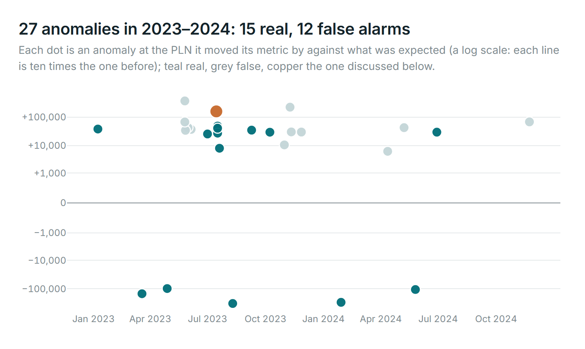
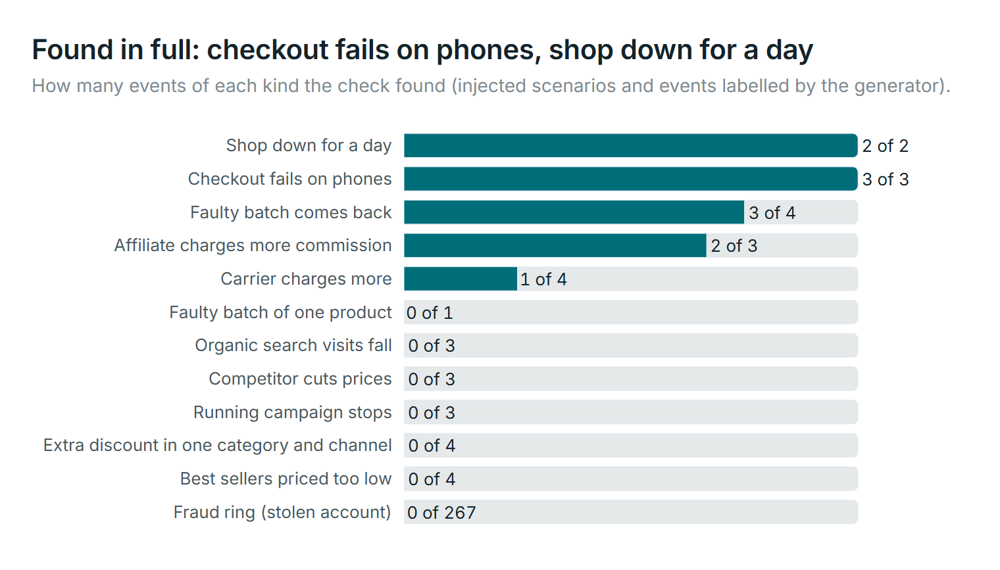
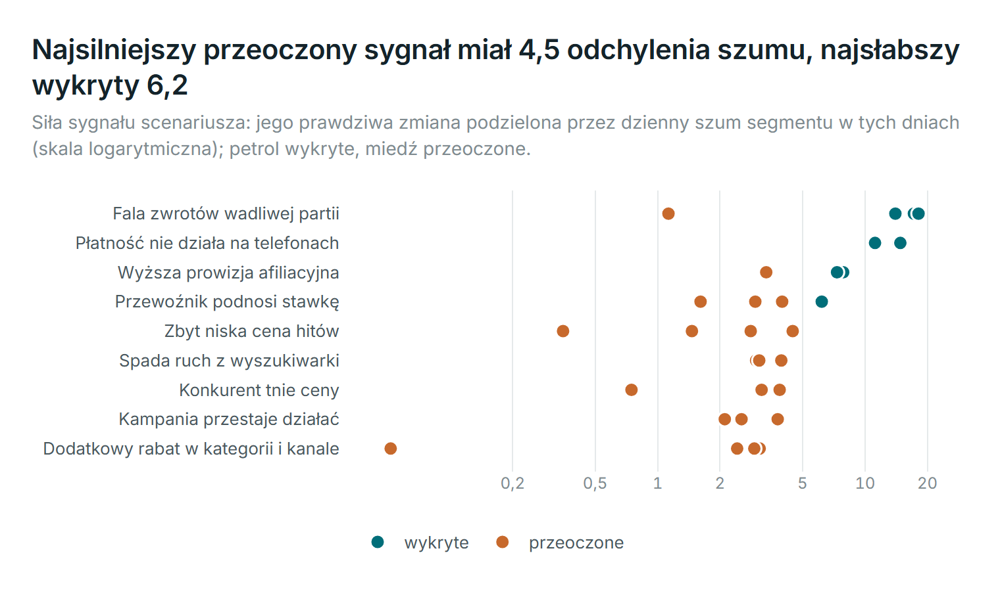
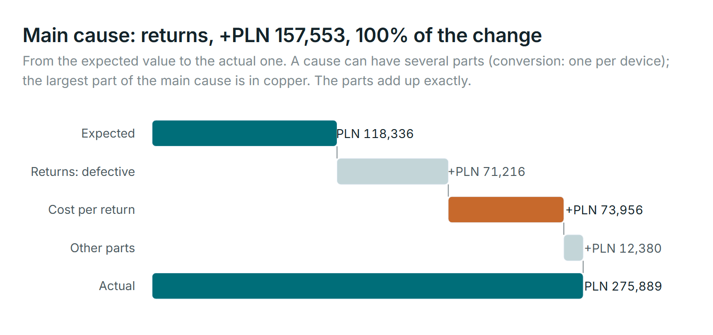
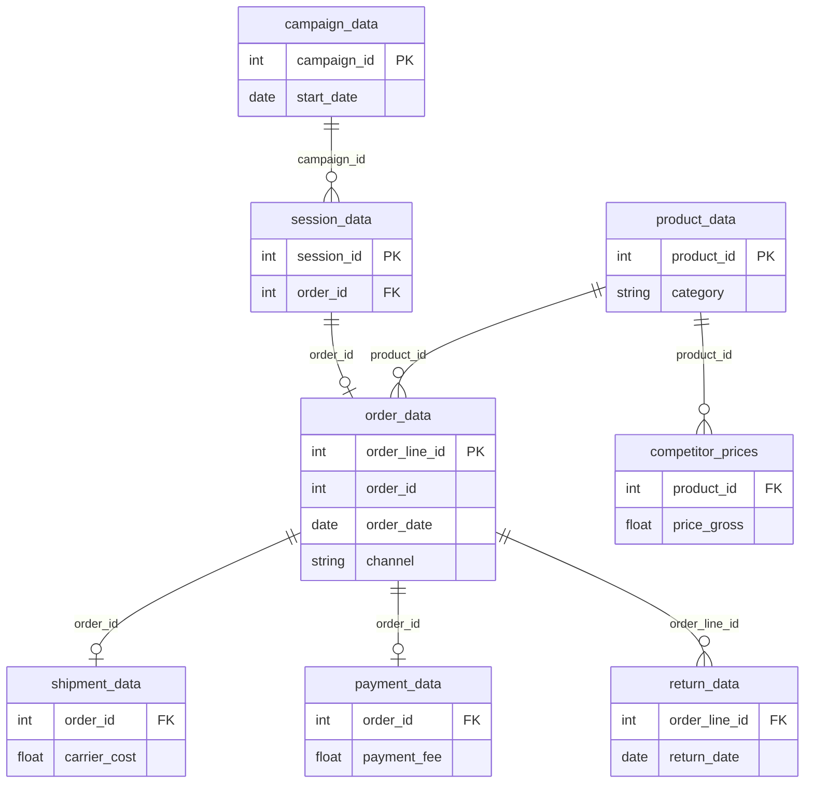

# Sales Anomalies

**English** | [Polski](READMEPL.md)

[](https://github.com/tlabedzki/Sales-Anomalies/actions/workflows/tests.yml)


[](https://github.com/tlabedzki/Sales-Anomalies/releases)

A case study: a daily check of Lumo, a fictional online shop, that finds unusual sales days and splits each into causes
in PLN.

**Problem.** The manager of an online shop sees yesterday's sales every morning but cannot tell whether a drop of a
dozen percent is ordinary noise or a sign that something broke: a discount, the carrier, a campaign or payments on
phones. Days pass before someone checks by hand, and money leaks out in the meantime.

**Approach.** Every day the code compares each part of the shop with a forecast built only from the past, splits every
deviation into causes that add up to the last grosz (0.01 PLN) and turns those numbers into one sentence for the
manager. Everything is graded against an answer key: anomalies injected into the data with a known cause, and events
labelled by the data generator itself.

<!-- generated:result -->
**Result.** Over two years of daily data the check raised 27 anomalies; 15 of them are events of the answer key (56%),
with 0.50 false alarms a month. It found 9 of 31 injected scenarios, every breakdown adds up exactly to the change, and
the main cause is right in 15 of 15 real anomalies.
<!-- /generated:result -->

<!-- generated:hero -->
<picture>
  <source media="(prefers-color-scheme: dark)" srcset="docs/img/app-demo-dark.svg">
  
</picture>
<!-- /generated:hero -->

**Stack:** Python · pandas · NumPy · DuckDB · Plotly · Dash · pytest

<!-- generated:summary -->
- **What worked:** checkout fails on phones (all found); most of: faulty batch comes back (3 of 4), affiliate charges
  more commission (2 of 3); shop outages of `anomaly_data` (2 of 2). Each of the 27 breakdowns adds up exactly to its
  change.
- **What missed:** organic search visits fall, competitor cuts prices, running campaign stops, extra discount in one
  category and channel, best sellers priced too low (none found): their changes have a median of 2.9 deviations of the
  daily noise and vanish in it. Of the 267 fraud rings in `anomaly_data` the check found 0.
<!-- /generated:summary -->

## 1. The Lumo shop and the manager's questions

Lumo is a fictional shop from [Data-Generator](https://github.com/tlabedzki/Data-Generator): 15 categories, 6 traffic
channels and about 730 order lines a day in 2021–2024. Every morning the manager wants to know whether anything moved
away from normal yesterday or over the last week, in which part of the shop, why and what it cost.

| Question | Method and tables | Answer to check against |
|---|---|---|
| Did sales, margin, returns, costs or conversion move away from normal in any part of the shop? | A forecast from the past and a z-score over 1 and 7 days (chapter 3) | Scenarios injected by the project and `anomaly_data` |
| Which changes does the check catch and which does it miss? | Every anomaly graded against the answer key (chapter 4) | `scenario_truth`: kind, segment, days and size of every change |
| Why did the result change and by how many PLN? | A margin bridge and an LMDI volume split (chapter 5) | The cause written into the scenario or the generator's event |
| How do you tell the manager in one sentence? | A sentence built from a sheet of facts and checked by code (chapter 6) | The sheet of facts computed by the code |

## 2. How we know the truth

The data are fully synthetic, so for every change we know whether it really happened and why. The project uses two
independent answer keys.

- **Scenarios injected by the project** (`scenarios.py`). Every two weeks the code writes one event of nine kinds into
  the generator's data, for example an extra discount in one category and one channel, a wave of returns from a faulty
  batch, a higher carrier rate, a competitor cutting prices, a campaign that stops working or checkout failing on
  phones. Each event changes the tables the way a real one would: a lower price also lowers the payment fee, the
  commission and a later refund, and a lost order takes its shipment and payment with it. The impact in PLN is the
  difference between the data after and before the injection, so it is exact.
- **Events labelled by the generator** (the `anomaly_data` table): fraud (a taken-over account places several
  expensive orders in 2–3 days), full-day shop outages and a wave of returns of one product.

The analysis sees neither key. An anomaly counts as real only when an event covers its days and segment and explains
at least 30% of the deviation it saw. With several hundred fraud cases one is always running somewhere, and a looser
match would credit them with every alarm nearby.

Two controls should come out close to zero. The first is a period without injections (March–May 2024): every alarm
the generator does not explain is false there. The second is the same shop with no scenarios at all. The alarm
thresholds were chosen on a second shop with a different random seed (seed 7), and the results come from the shop
with seed 42. Nothing is tuned on the data it is graded on.

## 3. Did anything happen today?

**Question.** Did any part of the shop move away yesterday or over the last week from what could be expected?

**What we did.** For each of 112 segments (the whole shop, 6 channels, 15 categories and 90 category × channel pairs)
a model forecasts every day only from the two years before it. It is a Poisson regression (a model for counts and
amounts) with weekday, month, trend, the shop's special days and the campaign calendar, refitted every month as in
the Farrington algorithm for disease surveillance. A level correction from the last weeks comes on top, because prices
and the range slowly change. The deviation is measured by a z-score (how many standard deviations a day lies from the
forecast) over one day and over 7 days. An alarm needs a z-score above the threshold of its group and a change above a
materiality threshold in PLN. One expensive order is not an anomaly: the test for jumps counts it as typical, and the
test for drops caps single lines at the 99th percentile of their category.

**How we check it.** Precision is the share of alarms the answer key explains (1 means no false alarm). Recall is the
share of events in the key that the check found.

**Result.**

<!-- generated:detection -->


In the period without injections (3 months) there were 2 false alarms. The same shop without any scenario gave 16
anomalies, 13 of them false (0.54 a month).
<!-- /generated:detection -->

**What it means for the manager.** At this threshold an alarm is rare and more often real than false, so it is worth
checking the same day. The threshold is a business decision: a lower one would find more but spend more time on false
leads.

## 4. What does the check catch and what does it miss?

**Question.** Which kinds of problems does the check see at once and which go unnoticed?

**What we did.** Every injected event and every generator event is graded: found or not. The signal of a scenario is
its true change in PLN (or in orders) divided by the noise the model expects in that segment on those days; it says
how many standard deviations separate the change from an ordinary day.

**How we check it.** An event is found when at least one anomaly covers its days and segment and the event explains
at least 30% of it.

**Result.**

<!-- generated:recall -->




Scenarios found have a median signal of 14.0 noise deviations, those missed 2.9; the weakest found 6.2, the strongest
missed 4.5.
<!-- /generated:recall -->

**What it means for the manager.** The daily check catches outages and large leaks. Lumo's daily sales move clearly
away from the forecast even with nothing wrong, so a drop of a dozen percent in one channel or category over a few
days blends into that noise. Such changes need other measures: the average discount per line, the cost of a parcel,
the return rate.

## 5. Why? Causes in PLN, to the last grosz

**Question.** Where did the change come from and how many PLN belong to each cause?

**What we did.** A margin bridge splits the gap between the expected and the actual value into parts, as in
controlling: volume, prices and mix, discount, shipping, payment fees, commission and, when one account with several
orders makes up a large part of the change, the orders of one account. Volume is split further with LMDI (the
logarithmic mean Divisia index, which splits a product into parts with no remainder) into visits, conversion and the
segment's share of orders. Returns split by return reason, costs by type and conversion by device. The code names the
cause of a volume change from evidence: no traffic in the whole shop is an outage, a channel with a running campaign
is a campaign and a category where a competitor cut prices is competitor prices. The parts are rounded with the
largest remainder method, so their sum equals the change to the grosz.

**How we check it.** The parts must add up to the change (a test on every anomaly), and the main cause must be the
cause of the event in the answer key.

**Result.**

<!-- generated:bridge -->


The note on this anomaly: “15–24 July 2023: cost of returns (Clothing) +PLN 157,553 (+133%) against what was expected,
mainly a higher cost per return (+PLN 73,956); check the batch of the most returned product.”
<!-- /generated:bridge -->

**What it means for the manager.** Instead of "margin fell" the manager gets a specific cause with an amount and knows
where to start: the discount settings, the carrier or the campaign.

## 6. A sentence for the manager from the computed numbers

**Question.** How do you turn a breakdown into one or two sentences that do not twist the numbers?

**What we did.** The code writes the facts of an anomaly into a sheet of ready-made strings: segment, days, the change
in PLN and percent, the three main causes with amounts, the evidence and a hint at what to check. From the sheet one
sentence is built from a fixed pattern for each language: days, metric and part of the shop, change, main cause with
its amount and what to check. When the cause is the metric itself (conversion, returns), the sentence names its
largest part, for example orders from phones.

**How we check it.** A check in code: every number in the sentence must be on the sheet with the same sign (a drop
cannot turn into a rise), with at most two sentences and 60 words.

**Result.**

<!-- generated:notes -->
Every one of the 27 anomalies has a note in Polish and in English: 54 sentences. 54 of 54 pass the number check; numbers
outside the sheet of facts: 0.
<!-- /generated:notes -->

**What it means for the manager.** One sentence with an amount and a cause, and every number in it comes from the
computation.

## 7. Analysis against the truth

<!-- generated:verdicts -->
The check raised 27 anomalies, 12 of them false alarms. Controls: 2 false alarms in the period without injections, 0.54
a month on the shop without scenarios.

| Event | Source | Found |
|---|---|---|
| Checkout fails on phones | injected | 3 of 3 |
| Faulty batch comes back | injected | 3 of 4 |
| Affiliate charges more commission | injected | 2 of 3 |
| Carrier charges more | injected | 1 of 4 |
| Organic search visits fall | injected | 0 of 3 |
| Competitor cuts prices | injected | 0 of 3 |
| Running campaign stops | injected | 0 of 3 |
| Extra discount in one category and channel | injected | 0 of 4 |
| Best sellers priced too low | injected | 0 of 4 |
| Shop down for a day | labelled by the generator | 2 of 2 |
| Faulty batch of one product | labelled by the generator | 0 of 1 |
| Fraud ring (stolen account) | labelled by the generator | 0 of 267 |
<!-- /generated:verdicts -->

**Where it went wrong and what it teaches.**

- **Discounts and wrong prices in one category.** A discount of 15–50 percentage points in one category and channel
  over a few days eats a large part of that cell's margin, but the cell has a few dozen lines a day and the margin of
  a single line scatters by a few hundred PLN. Lesson: watch discounts directly (average discount per line), not
  through margin.
- **Campaigns, search traffic and competitors.** The model knows when a campaign runs but not how strong it is, and a
  channel's sales swing a lot from day to day. Even a drop by half over three days does not break through this noise.
  Lesson: track a channel's traffic and conversion in sessions, not only in PLN.
- **Fraud in `anomaly_data`.** A taken-over account places a few expensive orders in a few cells, one or two in each,
  and daily electronics sales swing a lot anyway. It is an anomaly of an account, not of a segment. Lesson: fraud is
  caught at the customer level (many expensive orders from one account), not in sales totals.
- **False alarms.** Most are jumps in sales of the social media channel during campaigns (the model does not know
  their strength) and in the November peak: 11.11 and Black Friday. They are real changes, just not in the answer key.

Misses shown openly are part of the result. The answer key can say "missed" and "false alarm", so "found" means
something, and the limit of what can be detected is measured, not guessed.

## 8. Takeaways and limitations

**Recommendations.**

1. A daily check on sales and margin totals is good at finding outages, cost leaks and large return waves; run it
   every morning.
2. Discounts, prices and campaigns in single segments need separate, simpler measures (average discount, the price of
   best sellers, channel sessions), because in totals they vanish in the noise.
3. Deliver every alarm together with its breakdown into causes: the amount next to a cause says where to start.

**Limitations.** The data are synthetic and the daily noise comes from how the generator is built; a real shop adds
weather, integration failures and the season, and has no answer key. Then the test is a period without known events
and a manual review of some alarms. The grading covers one shop (seed 42), and the thresholds were chosen on one
other (seed 7). Scenarios do not overlap and skip November and December. The materiality threshold in PLN and the
false alarm budget are decisions made in the project.

## Quickstart

You need Git and Python 3.11. Clone the repository:

```bash
git clone https://github.com/tlabedzki/Sales-Anomalies.git
cd Sales-Anomalies
```

<details><summary>Create and activate a virtual environment with Python 3.11 (Windows, macOS and Linux)</summary>

Naming the version picks Python 3.11 even if another one is the default.

| Step | Windows (PowerShell) | macOS and Linux |
|---|---|---|
| Create | `py -3.11 -m venv .venv` | `python3.11 -m venv .venv` |
| Activate | `.venv\Scripts\Activate.ps1` | `source .venv/bin/activate` |
| Check | `python --version` prints `Python 3.11.x` | `python --version` prints `Python 3.11.x` |

If PowerShell says that running scripts is disabled, run `Set-ExecutionPolicy -Scope CurrentUser RemoteSigned` once
and activate again.

</details>

Then install the packages, generate the data, run the check and start the app:

```bash
pip install -r requirements.txt
python scripts/get_data.py
python main.py
python -m ui.app
```

`get_data.py` clones Data-Generator v1.7.1 and generates two shops (about 3 minutes). `main.py` runs two years of
checks, the grading against the key and the control without scenarios (about 4 minutes) and saves the results to
`output/`. The app runs at http://127.0.0.1:8050; stop it with Ctrl+C.

### Alarm thresholds

The thresholds are in the repository (`src/sales_anomalies/thresholds.json`); `python scripts/calibrate.py` chooses
them again on the shop with seed 7 (about 2 minutes).

## Data

The data are synthetic. [Data-Generator](https://github.com/tlabedzki/Data-Generator) v1.7.1 (MIT license) generates a
fictional shop; `scripts/get_data.py` runs it with no change to its code and with overridden settings: years
2021–2024, 1,060,000 order lines, 400,000 customers, seed 42 (results) and 7 (thresholds). That is about 10 times the
default, the size of a mid-sized online shop. Brand names in the data are real, the products are fictional.



The answer key is the generator's `anomaly_data` table (not linked by keys: an event points to days, a table and an
account) and this project's `scenario_truth` (`output/events.csv`). Amounts are net, without the 23% VAT.

## Why these tools

Each tool was picked for how this project reads its data: one run reads the generated tables from local files, joins
about a million order lines with products, shipments and payments, and refits small regressions on the past every
month. A fresh clone rebuilds everything with two commands, with no server, account, key or paid service.

| Tool | What it does here and why it fits | Alternative considered |
|---|---|---|
| Data Generator | Generates the fictional shop with its own answer key (`anomaly_data`), and this project injects scenarios of known cause and size on top; it runs at about 10 times the default size over four years. | A shop 5 times the default left a category in one channel with too few order lines a day, and with one year of history the trend and the months could not be told apart. |
| Parquet and pyarrow | `get_data.py` saves only the columns the check reads, with their types, and pyarrow reads the schema first, so a missing column stops the run with the command that fixes it. | – |
| pandas and numpy | Build the daily facts of every segment and fit the expected day in numpy: a Poisson regression for counts and a logistic one for conversion, only on the past and again every month, the approach of the Farrington algorithm from disease surveillance; the versions match Data Generator, which runs in this project's environment. | – |
| DuckDB | Computes what every sold line and every return is worth (sales, purchase cost, shipping, payment fee, commission) in one SQL query that joins four tables straight on the pandas frames, inside the process and without a server. | – |
| Plotly | Draws the charts of the app and of the README from the same functions, so both show the same numbers. | – |
| Dash and Mantine | The app, built from the same blocks as every app in this portfolio. | Streamlit and Gradio were ruled out for all apps in the portfolio: they sit side by side on the GitHub profile and a different look stands out. |
| pytest | Tests on a small synthetic shop with no data files and no network, so CI checks the code without running the generator. | – |

## Project structure

<details><summary>Show the tree</summary>

```
main.py                        two years of checks, grading, results to output/
scripts/get_data.py            Data-Generator v1.7.1 -> data/raw/seed-42, seed-7
scripts/calibrate.py           alarm thresholds from seed 7 -> src/sales_anomalies/thresholds.json
scripts/make_charts.py         README charts and generated blocks (readme_blocks.py)
scripts/make_demo_svg.py       animated hero from app screenshots
src/sales_anomalies/
  economics.py                 economics of lines and returns (SQL in DuckDB)
  facts.py                     daily facts of 112 segments
  baseline.py                  forecast from the past (Poisson regression, level)
  detect.py                    z-scores, alarms, episodes, the narrowest segment
  calibrate.py                 thresholds from seed 7
  scenarios.py                 injected anomalies and their truth
  truth.py, evaluate.py        answer key and grading
  decompose.py                 causes in PLN to the grosz
  notes.py                     the sentence for the manager and the number check
ui/app.py                      Dash + Mantine app
tests/                         pytest on a small synthetic shop
```

</details>

## Tests

```bash
pip install -r requirements-dev.txt
python -m pytest
```

45 tests check on a small synthetic shop (no data files and no network, about 15 s): line economics, forecasts only
from the past, scenario injection, detection, parts adding up to the grosz, the number check of the notes and the app
views.

## License

MIT, see [LICENSE](LICENSE). [Changelog](CHANGELOG.md).

README last updated: 2026-11-27
