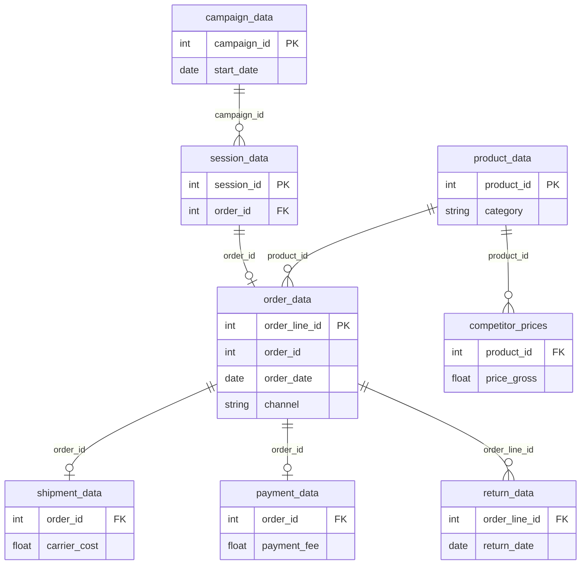

# Sales Anomalies

[](https://github.com/tlabedzki/Sales-Anomalies/actions/workflows/tests.yml)


Studium przypadku: codzienna kontrola sprzedaży fikcyjnego sklepu Lumo, która znajduje nietypowe dni, rozkłada je na
przyczyny w złotych i opisuje je zdaniem dla kierownika.

**Problem.** Kierownik sklepu internetowego widzi rano sprzedaż z wczoraj, ale nie wie, czy spadek o kilkanaście
procent to zwykły szum, czy sygnał, że coś się zepsuło: rabat, przewoźnik, kampania albo płatności na telefonach.
Zanim ktoś to sprawdzi ręcznie, mijają dni, a pieniądze uciekają.

**Podejście.** Kod codziennie porównuje każdy fragment sklepu z prognozą liczoną tylko z przeszłości, rozkłada
każde odchylenie na przyczyny, które sumują się co do grosza, a model językowy opisuje gotowe liczby i niczego nie
liczy sam. Wszystko jest oceniane kluczem odpowiedzi: anomaliami wstrzykniętymi do danych o znanej przyczynie
i zdarzeniami, które oznaczył sam generator danych.

<!-- generated:result -->
**Wynik.** Wynik pojawi się po pierwszym przebiegu `python scripts/make_charts.py`.
<!-- /generated:result -->

<!-- generated:hero -->
<!-- /generated:hero -->

**Stack:** Python · pandas · NumPy · DuckDB · Plotly · Dash · Claude API · pytest

<!-- generated:summary -->
<!-- /generated:summary -->

## 1. Sklep Lumo i pytania kierownika

Lumo to fikcyjny sklep z [Data-Generatora](https://github.com/tlabedzki/Data-Generator): 15 kategorii, 6 kanałów
ruchu, ok. 730 linii zamówień dziennie w latach 2021–2024. Kierownik co rano chce wiedzieć, czy wczoraj albo
w ostatnim tygodniu coś odbiegło od normy, w której części sklepu, dlaczego i ile to kosztowało.

| Pytanie | Jak odpowiada analiza | Gdzie leży prawdziwa odpowiedź |
|---|---|---|
| Czy w którejś części sklepu sprzedaż, marża, zwroty, koszty albo konwersja odbiegły od normy? | Prognoza z przeszłości i z-score na dzień i na 7 dni (rozdział 3) | Scenariusze wstrzyknięte przez projekt i `anomaly_data` |
| Które zmiany wykrywanie łapie, a które gubi? | Ocena każdej anomalii kluczem odpowiedzi (rozdział 4) | `scenario_truth`: rodzaj, segment, dni i wielkość każdej zmiany |
| Dlaczego wynik się zmienił i za ile złotych? | Most marży i rozkład wolumenu LMDI (rozdział 5) | Przyczyna wpisana w scenariusz albo w zdarzenie generatora |
| Jak powiedzieć to kierownikowi bez zmyślonych liczb? | Notatka modelu językowego sprawdzana kodem (rozdział 6) | Arkusz faktów policzony przez kod |

## 2. Skąd wiadomo, co jest prawdą

Dane są w całości syntetyczne, więc dla każdej zmiany wiadomo, czy naprawdę zaszła i dlaczego. Projekt korzysta
z dwóch niezależnych kluczy odpowiedzi.

- **Scenariusze wstrzyknięte przez projekt** (`scenarios.py`). Na danych generatora kod dopisuje 31 zdarzeń
  dziewięciu rodzajów, np. dodatkowy rabat w jednej kategorii i jednym kanale, falę zwrotów wadliwej partii, wyższą
  stawkę przewoźnika, konkurenta, który tnie ceny, kampanię, która przestaje działać, albo płatność, która nie działa
  na telefonach. Każde zdarzenie zmienia tabele tak, jak zrobiłoby to prawdziwe: niższa cena obniża też płatność,
  prowizję i późniejszy zwrot, a utracone zamówienie zabiera ze sobą przesyłkę i płatność. Wpływ w złotych to
  różnica danych po wstrzyknięciu i przed nim, więc jest dokładny.
- **Zdarzenia oznaczone przez generator** (tabela `anomaly_data`): oszustwa (przejęte konto składa w 2–3 dni kilka
  drogich zamówień), całodniowe awarie sklepu i fala zwrotów jednego produktu.

Analiza nie widzi żadnego z tych kluczy. Anomalia liczy się jako prawdziwa tylko wtedy, gdy zdarzenie dotyczy jej
dni i segmentu oraz wyjaśnia co najmniej 30% odchylenia, które zobaczyła. Przy kilkuset oszustwach któreś zawsze
gdzieś trwa, a luźniejsze dopasowanie przypisywałoby im każdy alarm w pobliżu.

Dwie kontrole powinny wyjść bliskie zera. Pierwsza to okres bez wstrzyknięć (marzec–maj 2024): każdy alarm, którego
nie wyjaśnia generator, jest tam fałszywy. Druga to ten sam sklep w ogóle bez scenariuszy. Progi alarmów
dobrano na drugim sklepie z innym ziarnem losowania (seed 7), a wyniki podaje sklep z ziarnem 42. Nic nie jest więc
strojone na danych, na których jest oceniane.

## 3. Czy coś się dziś stało?

**Pytanie.** Czy któraś część sklepu odbiegła wczoraj albo w ostatnim tygodniu od tego, czego można się było
spodziewać?

**Co robi analiza.** Dla każdego ze 112 segmentów (cały sklep, 6 kanałów, 15 kategorii i 90 par kategoria × kanał)
model prognozuje każdy dzień tylko z dwóch lat przed nim. To regresja Poissona (model dla liczb zdarzeń i kwot) z dniem
tygodnia, miesiącem, trendem, dniami specjalnymi sklepu i kalendarzem kampanii, przeliczana co miesiąc, jak
w algorytmie Farringtona do nadzoru nad zachorowaniami. Do tego dochodzi poprawka o poziom z ostatnich tygodni, bo
ceny i asortyment powoli się zmieniają. Odchylenie mierzy z-score (o ile odchyleń standardowych dzień jest od
prognozy) na jeden dzień i na 7 dni. Alarm wymaga z-score ponad progiem swojej grupy i zmiany ponad próg istotności
w złotych. Jedno drogie zamówienie nie jest anomalią: do testu skoku liczy się jako typowe, a do testu spadku pojedyncze linie są
przycinane do 99. percentyla ich kategorii.

**Jak to sprawdzamy.** Precyzja to odsetek alarmów, które wyjaśnia klucz odpowiedzi (1 = żadnego fałszywego
alarmu). Czułość to odsetek zdarzeń z klucza, które wykrywanie znalazło.

**Wynik.**

<!-- generated:detection -->
<!-- /generated:detection -->

**Co to znaczy dla kierownika.** Przy takim progu alarm jest rzadki i zwykle prawdziwy, więc warto go sprawdzić tego
samego dnia. Próg to decyzja biznesowa: niższy znalazłby więcej, ale zabrałby więcej czasu na fałszywe tropy.

## 4. Co wykrywanie łapie, a co gubi?

**Pytanie.** Które rodzaje problemów kontrola widzi od razu, a które przechodzą niezauważone?

**Co robi analiza.** Każde wstrzyknięte zdarzenie i każde zdarzenie generatora dostaje ocenę: znalezione albo nie.
Wielkość scenariusza to zmiana jego głównej metryki w jego segmencie i dniach wobec poziomu bez wstrzyknięcia.

**Jak to sprawdzamy.** Zdarzenie jest znalezione, gdy co najmniej jedna anomalia dotyczy jego dni i segmentu oraz
wyjaśnia ją w co najmniej 30%.

**Wynik.**

<!-- generated:recall -->
<!-- /generated:recall -->

**Co to znaczy dla kierownika.** Kontrola dzienna łapie awarie i duże przecieki. Dzienna sprzedaż Lumo waha się
jednak o ok. 13% od prognozy nawet bez żadnego problemu, więc kilkunastoprocentowy spadek w jednym kanale albo
kategorii przez parę dni zlewa się z tym szumem. Takie zmiany trzeba śledzić innymi miarami: rabat średni na linię,
koszt paczki, odsetek zwrotów.

## 5. Dlaczego? Przyczyny w złotych co do grosza

**Pytanie.** Skąd wzięła się zmiana i ile złotych przypada na każdą przyczynę?

**Co robi analiza.** Most marży, czyli rozpisanie różnicy między wartością oczekiwaną a rzeczywistą na składniki,
tak jak w controllingu: wolumen, ceny i asortyment, rabat, wysyłka, opłaty za płatności, prowizja, a gdy jedno konto
z kilkoma zamówieniami robi dużą część zmiany, także zamówienia jednego konta. Wolumen dzieli się dalej metodą LMDI
(logarytmiczny indeks Divisii, który rozkłada iloczyn na składniki bez reszty) na odwiedziny, konwersję i udział
segmentu w zamówieniach. Zwroty dzielą się według powodu zwrotu, koszty według rodzaju, a konwersja według
urządzenia. Nazwę przyczyny wolumenu kod nadaje na podstawie dowodów: brak ruchu w całym sklepie to awaria, kanał
z trwającą kampanią to kampania, a kategoria, w której konkurent obniżył ceny, to ceny konkurencji. Części są
zaokrąglane metodą największych reszt, więc ich suma równa się zmianie co do grosza.

**Jak to sprawdzamy.** Suma części musi się równać zmianie (test na każdej anomalii), a główna przyczyna musi być
przyczyną zdarzenia z klucza odpowiedzi.

**Wynik.**

<!-- generated:bridge -->
<!-- /generated:bridge -->

**Co to znaczy dla kierownika.** Zamiast „marża spadła” dostaje konkretną przyczynę z kwotą i wie, gdzie zacząć:
w ustawieniach rabatów, u przewoźnika albo w kampanii.

## 6. Zdanie dla kierownika: kod liczy, AI tłumaczy

**Pytanie.** Jak zamienić rozkład na jedno albo dwa zdania, które nie przekręcą liczb?

**Co robi analiza.** Kod zapisuje fakty anomalii w arkuszu gotowych napisów: segment, dni, zmianę w złotych
i procentach, trzy główne przyczyny z kwotami, dowody i podpowiedź, co sprawdzić. Model Claude Haiku 5.5 (najtańszy
aktualny model Claude, z wyjściem w ustalonym formacie JSON) przepisuje arkusz na notatkę. Kod sprawdza każdą liczbę
w notatce: musi stać w arkuszu, inaczej notatka wraca do modelu z listą błędów, a po drugiej odmowie zostaje
zdanie z szablonu kodu. Notatki są zapisane w repozytorium (`data/explanations.json`), więc aplikacja i README
działają bez klucza API.

**Jak to sprawdzamy.** Evale w `evals/` oceniają kodem pierwszą wersję notatki z każdego przypadku: zero liczb spoza
arkusza, najwyżej dwa zdania i 50 słów, nazwana główna przyczyna, segment i kwota, zgodny kierunek zmiany.

**Wynik.**

<!-- generated:notes -->
<!-- /generated:notes -->

**Co to znaczy dla kierownika.** Czyta zdanie, które brzmi jak od analityka, a każda liczba w nim pochodzi z kodu.

## 7. Analiza kontra prawda

<!-- generated:verdicts -->
<!-- /generated:verdicts -->

**Gdzie metody się pomyliły i czego to uczy.**

- **Rabaty i błędne ceny w jednej kategorii.** Rabat o 15–50 punktów procentowych w jednej kategorii i kanale przez
  kilka dni zjada dużą część marży tej komórki, ale komórka ma kilkadziesiąt linii dziennie, a marża pojedynczej
  linii rozrzuca się o kilkaset złotych. Lekcja: rabat warto pilnować wprost (średni rabat na linię), nie przez
  marżę.
- **Kampanie, ruch z wyszukiwarki i konkurencja.** Model wie, kiedy kampania trwa, ale nie zna jej siły, a sprzedaż
  kanału waha się z dnia na dzień o ponad 20%. Spadek o połowę przez trzy dni jest na granicy wykrywalności.
  Lekcja: ruch i konwersję kanału trzeba śledzić w sesjach, nie tylko w złotych.
- **Oszustwa z `anomaly_data`.** Przejęte konto składa kilka drogich zamówień w paru komórkach, po jednym czy dwa
  w każdej, a dzienna sprzedaż elektroniki waha się o kilkanaście tysięcy złotych. To anomalia konta, nie segmentu.
  Lekcja: oszustwa łapie się na poziomie klienta (wiele drogich zamówień z jednego konta), nie na sumach sprzedaży.
- **Fałszywe alarmy.** Większość to skoki w kanale mediów społecznościowych w czasie mocniejszych niż zwykle kampanii
  i dni wokół Black Friday. To realne zmiany, tylko nie są w kluczu odpowiedzi.

Pomyłki pokazane wprost to część wyniku. Klucz odpowiedzi umie powiedzieć „przeoczone” i „fałszywy alarm”, więc
„znalezione” coś znaczy, a granica wykrywalności jest zmierzona, nie zgadnięta.

## 8. Wnioski i ograniczenia

**Rekomendacje.**

1. Codzienna kontrola na sumach sprzedaży i marży nadaje się do wykrywania awarii, przecieków kosztów i dużych fal
   zwrotów; warto ją uruchamiać każdego ranka.
2. Rabaty, ceny i kampanie w pojedynczych segmentach wymagają osobnych, prostszych miar (średni rabat, cena
   najlepiej sprzedających się produktów, sesje kanału), bo w sumach giną w szumie.
3. Każdy alarm warto dostarczać razem z rozkładem na przyczyny: kwota przy przyczynie mówi, od czego zacząć.

**Ograniczenia.** Dane są syntetyczne, a szum dzienny wynika z budowy generatora; w prawdziwym sklepie dochodzą
pogoda, awarie integracji i sezon, a klucza odpowiedzi nie ma. Wtedy sprawdzianem zostaje okres bez znanych
zdarzeń i ręczna weryfikacja części alarmów. Ocena dotyczy jednego sklepu (seed 42), a progi dobrano na jednym innym
(seed 7). Scenariusze nie nakładają się na siebie i omijają listopad i grudzień. Próg istotności w złotych i budżet
fałszywych alarmów to decyzje przyjęte w projekcie.

## Szybki start

Potrzebujesz Gita i Pythona 3.11. Sklonuj repozytorium:

```bash
git clone https://github.com/tlabedzki/Sales-Anomalies.git
cd Sales-Anomalies
```

<details><summary>Utwórz i włącz środowisko wirtualne z Pythonem 3.11 (Windows, macOS i Linux)</summary>

Podanie wersji wybiera Pythona 3.11, nawet jeśli domyślny jest inny.

| Krok | Windows (PowerShell) | macOS i Linux |
|---|---|---|
| Utworzenie | `py -3.11 -m venv .venv` | `python3.11 -m venv .venv` |
| Włączenie | `.venv\Scripts\Activate.ps1` | `source .venv/bin/activate` |
| Sprawdzenie | `python --version` pokazuje `Python 3.11.x` | `python --version` pokazuje `Python 3.11.x` |

Jeśli PowerShell odpowie, że uruchamianie skryptów jest wyłączone, wykonaj raz
`Set-ExecutionPolicy -Scope CurrentUser RemoteSigned` i włącz środowisko ponownie.

</details>

Potem zainstaluj pakiety, wygeneruj dane, uruchom kontrolę i aplikację:

```bash
pip install -r requirements.txt
python scripts/get_data.py
python main.py
python -m ui.app
```

`get_data.py` klonuje Data-Generator v1.7.1 i generuje dwa sklepy (ok. 3 minuty). `main.py` liczy dwa lata
kontroli, ocenę kluczem i kontrolę bez scenariuszy (ok. 4 minut) i zapisuje wyniki do `output/`. Aplikacja działa pod
adresem http://127.0.0.1:8050; zatrzymasz ją przez Ctrl+C.

### Model językowy

Notatki są zapisane w repozytorium, więc klucz nie jest potrzebny. Żeby napisać brakujące notatki na żywo, wpisz
`ANTHROPIC_API_KEY=...` do pliku `.env` w katalogu projektu i uruchom `python main.py --live`. Evale:
`python -m evals.run` (jeden przebieg) albo `python -m evals.run --repeat 3`.

## Dane

Dane są syntetyczne. [Data-Generator](https://github.com/tlabedzki/Data-Generator) v1.7.1 (licencja MIT) generuje
fikcyjny sklep; `scripts/get_data.py` uruchamia go bez zmian w kodzie, z nadpisanymi ustawieniami: lata 2021–2024,
1 060 000 linii zamówień, 400 000 klientów, ziarno 42 (wyniki) i 7 (progi). To ok. 10 razy więcej niż domyślnie,
tyle co średni sklep internetowy. Nazwy marek w danych są prawdziwe, produkty fikcyjne.



Klucz odpowiedzi to tabela `anomaly_data` generatora (bez relacji kluczami: zdarzenie wskazuje dni, tabelę i konto)
oraz `scenario_truth` tego projektu (`output/events.csv`). Kwoty są netto, bez 23% VAT.

## Struktura projektu

<details><summary>Pokaż drzewo</summary>

```
main.py                        kontrola dwóch lat, ocena kluczem, zapis do output/
scripts/get_data.py            Data-Generator v1.7.1 -> data/raw/seed-42, seed-7
scripts/make_charts.py         wykresy README i bloki generated (readme_blocks.py)
scripts/make_demo_svg.py       animowany hero z zrzutów aplikacji
src/sales_anomalies/
  economics.py                 ekonomia linii i zwrotów (SQL w DuckDB)
  facts.py                     dzienne fakty 112 segmentów
  baseline.py                  prognoza z przeszłości (regresja Poissona, poziom)
  detect.py                    z-score, alarmy, epizody, najwęższy segment
  calibrate.py                 progi z seed 7
  scenarios.py                 wstrzyknięte anomalie i ich prawda
  truth.py, evaluate.py        klucz odpowiedzi i ocena
  decompose.py                 przyczyny w złotych co do grosza
  explain.py                   notatki modelu i kontrola liczb
evals/                         przypadki, oceny kodem, wyniki
ui/app.py                      aplikacja Dash + Mantine
tests/                         pytest na małym sklepie syntetycznym
```

</details>

## Testy

```bash
pip install -r requirements-dev.txt
python -m pytest
```

45 testów sprawdza na małym sklepie syntetycznym (bez plików danych i bez sieci, ok. 20 s): ekonomię linii, prognozę
tylko z przeszłości, wstrzykiwanie scenariuszy, wykrywanie, sumę części co do grosza, kontrolę liczb w notatkach
i widoki aplikacji.

## Licencja

MIT, zobacz [LICENSE](LICENSE). [Changelog](CHANGELOG.md).

Ostatnia aktualizacja README: 2026-11-25
