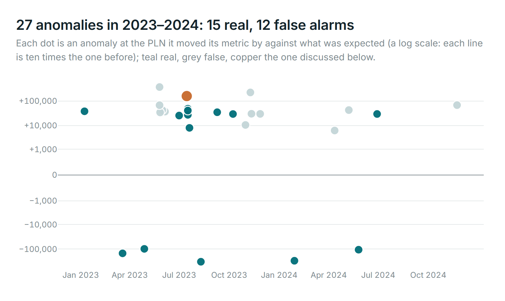
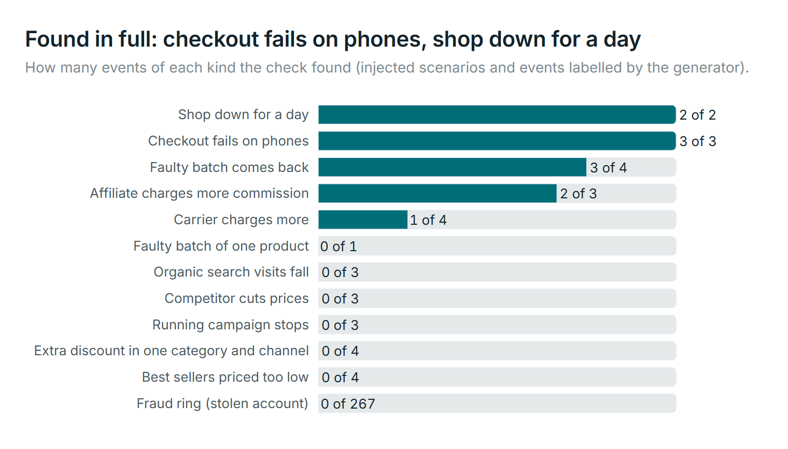
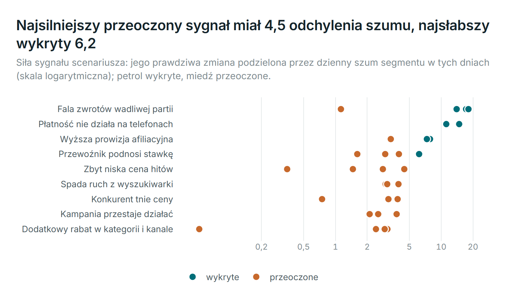
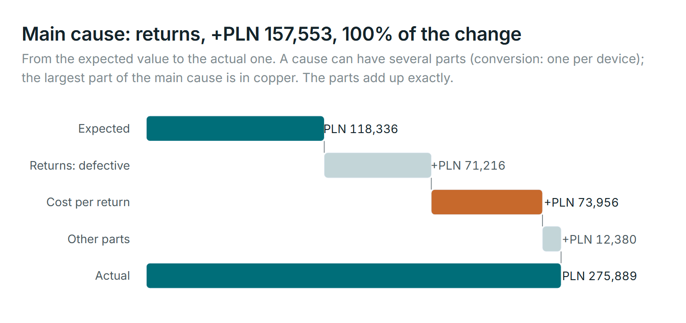
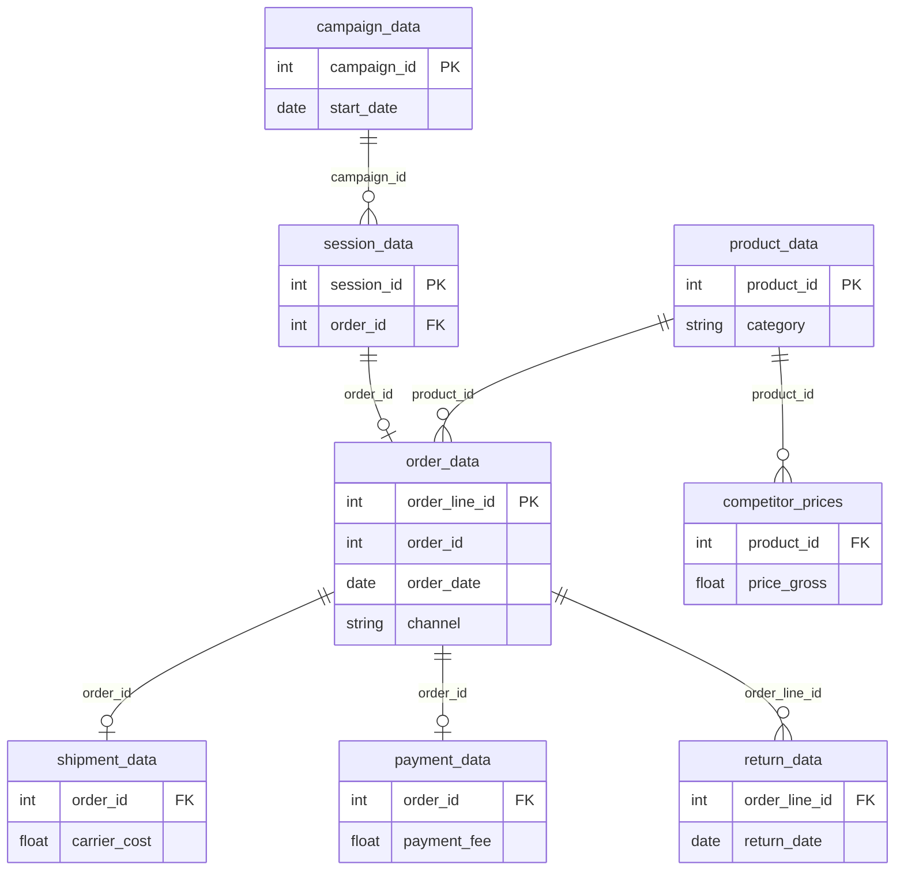

# Sales Anomalies

[](https://github.com/tlabedzki/Sales-Anomalies/actions/workflows/tests.yml)


[](https://github.com/tlabedzki/Sales-Anomalies/releases)
[](README.md)

Studium przypadku: codzienna kontrola fikcyjnego sklepu internetowego Lumo, która znajduje nietypowe dni sprzedaży
i rozkłada każdy z nich na przyczyny w złotych.

**Problem.** Kierownik sklepu internetowego co rano widzi wczorajszą sprzedaż, ale nie wie, czy spadek o kilkanaście
procent to zwykły szum (noise), czy znak, że coś się zepsuło: rabat, przewoźnik, kampania albo płatności na
telefonach. Szum to przypadkowe wahania sprzedaży z dnia na dzień. Zanim ktoś sprawdzi to ręcznie, mijają dni,
a pieniądze w tym czasie uciekają.

**Podejście.** Kod codziennie porównuje każdą część sklepu z prognozą (forecast) liczoną wyłącznie z przeszłości.
Każde odchylenie rozkłada na przyczyny, które sumują się co do ostatniego grosza (0,01 zł), a z tych liczb składa
jedno zdanie dla kierownika. Wszystko jest oceniane kluczem odpowiedzi (answer key), czyli listą zdarzeń, o których
wiadomo, co naprawdę zaszło: anomaliami o znanej przyczynie wstrzykniętymi do danych i zdarzeniami, które oznaczył sam
generator danych.

<!-- generated:result -->
**Wynik.** W dwóch latach dziennych danych wykrywanie zgłosiło 27 anomalii; 15 z nich to zdarzenia z klucza odpowiedzi
(56%), przy 0,50 fałszywego alarmu na miesiąc. Znalazło 9 z 31 wstrzykniętych scenariuszy, każdy rozkład zgadza się ze
zmianą co do grosza, a główna przyczyna jest trafna w 15 z 15 prawdziwych anomalii.
<!-- /generated:result -->

<!-- generated:hero -->
<picture>
  <source media="(prefers-color-scheme: dark)" srcset="docs/img/app-demo-dark.svg">
  
</picture>
<!-- /generated:hero -->

**Stack:** Python · pandas · NumPy · DuckDB · Plotly · Dash · pytest

<!-- generated:summary -->
- **Trafione:** płatność nie działa na telefonach (wszystkie przypadki); w większości: fala zwrotów wadliwej partii (3 z
  4), wyższa prowizja afiliacyjna (2 z 3); awarie sklepu z `anomaly_data` (2 z 2). Każde z 27 rozbić sumuje się do
  zmiany co do grosza.
- **Chybione:** spada ruch z wyszukiwarki, konkurent tnie ceny, kampania przestaje działać, dodatkowy rabat w kategorii
  i kanale, zbyt niska cena hitów (0 trafień): ich zmiany mają medianę 2,9 odchylenia dziennego szumu i giną w nim. Z
  267 oszustw z `anomaly_data` wykrywanie znalazło 0.
<!-- /generated:summary -->

## 1. Sklep Lumo i pytania kierownika

Lumo to fikcyjny sklep z [Data-Generatora](https://github.com/tlabedzki/Data-Generator): 15 kategorii, 6 kanałów
ruchu i ok. 730 linii zamówień (order lines, czyli pozycji zamówienia: produkt i liczba jego sztuk) dziennie
w latach 2021–2024. Kierownik co rano chce wiedzieć, czy wczoraj albo w ostatnim tygodniu coś odbiegło od normy,
w której części sklepu, dlaczego i ile to kosztowało.

| Pytanie | Jak odpowiada analiza | Gdzie leży prawdziwa odpowiedź |
|---|---|---|
| Czy w którejś części sklepu sprzedaż, marża, zwroty, koszty albo konwersja (odsetek wizyt zakończonych zamówieniem) odbiegły od normy? | Prognoza z przeszłości i z-score na 1 i na 7 dni (rozdział 3) | Scenariusze wstrzyknięte przez projekt i `anomaly_data` |
| Które zmiany wykrywanie łapie, a które gubi? | Ocena każdej anomalii kluczem odpowiedzi (rozdział 4) | `scenario_truth`: rodzaj, segment, dni i wielkość każdej zmiany |
| Dlaczego wynik się zmienił i o ile złotych? | Most marży i rozkład wolumenu metodą LMDI (rozdział 5) | Przyczyna wpisana w scenariusz albo w zdarzenie generatora |
| Jak powiedzieć to kierownikowi jednym zdaniem? | Zdanie złożone z arkusza faktów i sprawdzone kodem (rozdział 6) | Arkusz faktów policzony przez kod |

## 2. Skąd wiadomo, co jest prawdą

Dane są w całości syntetyczne, więc o każdej zmianie wiadomo, czy naprawdę zaszła i dlaczego. Projekt korzysta
z dwóch niezależnych kluczy odpowiedzi.

- **Scenariusze wstrzyknięte przez projekt** (`scenarios.py`). Co dwa tygodnie kod dopisuje do danych generatora jedno
  zdarzenie jednego z dziewięciu rodzajów, np. dodatkowy rabat w jednej kategorii i jednym kanale, falę zwrotów
  wadliwej partii, wyższą stawkę przewoźnika, konkurenta, który tnie ceny, kampanię, która przestaje działać, albo
  płatność, która nie działa na telefonach. Każde zdarzenie zmienia tabele tak, jak zrobiłoby to prawdziwe: niższa cena
  obniża też opłatę za płatność, prowizję i późniejszy zwrot pieniędzy, a utracone zamówienie zabiera ze sobą przesyłkę
  i płatność. Wpływ w złotych to różnica między danymi po wstrzyknięciu i przed nim, więc jest dokładny.
- **Zdarzenia oznaczone przez generator** (tabela `anomaly_data`): oszustwa (przejęte konto składa w 2–3 dni kilka
  drogich zamówień), całodniowe awarie sklepu i fala zwrotów jednego produktu.

Analiza nie widzi żadnego z tych kluczy. Anomalia liczy się jako prawdziwa tylko wtedy, gdy zdarzenie obejmuje jej dni
i segment (część sklepu: kanał, kategorię albo ich parę) oraz wyjaśnia co najmniej 30% odchylenia tej anomalii.
Przy kilkuset oszustwach któreś zawsze gdzieś trwa, a luźniejsze dopasowanie przypisywałoby im każdy alarm w pobliżu.

Dwie kontrole powinny wyjść bliskie zera. Pierwsza to okres bez wstrzyknięć (marzec–maj 2024): każdy alarm, którego
nie wyjaśnia generator, jest tam fałszywy. Druga to ten sam sklep w ogóle bez scenariuszy. Progi alarmów dobrano na
drugim sklepie z innym ziarnem losowania (seed 7), a wyniki pochodzą ze sklepu z ziarnem 42. Nic nie jest więc
strojone na danych, na których jest oceniane. Ziarno (seed) to liczba startowa generatora losowego: to samo ziarno
daje te same dane, a inne daje inny sklep o tych samych regułach.

## 3. Czy coś się dziś stało?

**Pytanie.** Czy któraś część sklepu odbiegła wczoraj albo w ostatnim tygodniu od tego, czego można się było
spodziewać?

**Co robi analiza.** Dla każdego ze 112 segmentów (cały sklep, 6 kanałów, 15 kategorii i 90 par kategoria × kanał)
model prognozuje każdy dzień wyłącznie z dwóch lat przed nim. To regresja Poissona (Poisson regression), czyli model
dla liczb zdarzeń i kwot. Uwzględnia dzień tygodnia, miesiąc, trend, dni specjalne sklepu i kalendarz kampanii.
Model jest dopasowywany od nowa co miesiąc, tak jak w algorytmie Farringtona (Farrington algorithm), którym służby
zdrowia wychwytują nietypowy wzrost zachorowań. Do tego dochodzi poprawka poziomu z ostatnich tygodni, bo ceny
i asortyment powoli się zmieniają. Odchylenie mierzy z-score (wynik standaryzowany), czyli liczba odchyleń
standardowych między dniem a prognozą; liczy się go dla jednego dnia i dla 7 dni. Alarm wymaga z-score powyżej
progu swojej grupy i zmiany powyżej progu istotności (materiality threshold), czyli najmniejszej kwoty w złotych,
przy której zmiana ma znaczenie dla biznesu. Jedno drogie zamówienie nie jest anomalią: test skoków traktuje je jako
typowe, a test spadków przycina pojedyncze linie do 99. percentyla ich kategorii, czyli do wartości, którą przekracza
tylko co setna linia.

**Jak to sprawdzamy.** Precyzja (precision) to odsetek alarmów, które wyjaśnia klucz odpowiedzi (1 oznacza brak
fałszywych alarmów). Czułość (recall) to odsetek zdarzeń z klucza, które wykrywanie znalazło.

**Wynik.**

<!-- generated:detection -->


Okres bez wstrzyknięć (3 miesiące): 2 fałszywe alarmy. Ten sam sklep bez żadnego scenariusza: 16 anomalii, w tym 13
fałszywych alarmów (0,54 na miesiąc).
<!-- /generated:detection -->

**Co to znaczy dla kierownika.** Przy takim progu alarm jest rzadki i częściej prawdziwy niż fałszywy, więc warto go
sprawdzić tego samego dnia. Próg to decyzja biznesowa: niższy znalazłby więcej, ale zabrałby więcej czasu na fałszywe
tropy.

## 4. Co wykrywanie łapie, a co gubi?

**Pytanie.** Które rodzaje problemów kontrola widzi od razu, a które przechodzą niezauważone?

**Co robi analiza.** Każde wstrzyknięte zdarzenie i każde zdarzenie generatora dostaje ocenę: znalezione albo nie.
Sygnał scenariusza to jego prawdziwa zmiana w złotych (albo w zamówieniach) podzielona przez szum, jakiego model
spodziewa się w tym segmencie w tych dniach. Ta miara mówi, ile odchyleń standardowych dzieli zmianę od zwykłego dnia.

**Jak to sprawdzamy.** Zdarzenie jest znalezione, gdy co najmniej jedna anomalia obejmuje jego dni i segment, a samo
zdarzenie wyjaśnia co najmniej 30% tej anomalii.

**Wynik.**

<!-- generated:recall -->




Wykryte scenariusze mają medianę sygnału 14,0 odchylenia szumu, przeoczone 2,9; najsłabszy wykryty 6,2, najsilniejszy
przeoczony 4,5.
<!-- /generated:recall -->

**Co to znaczy dla kierownika.** Kontrola dzienna łapie awarie i duże przecieki. Dzienna sprzedaż Lumo wyraźnie
odbiega od prognozy nawet wtedy, gdy nic się nie dzieje, więc kilkunastoprocentowy spadek w jednym kanale albo
kategorii przez kilka dni zlewa się z tym szumem. Takie zmiany wymagają innych miar: średniego rabatu na linię,
kosztu paczki, odsetka zwrotów.

## 5. Dlaczego? Przyczyny w złotych co do grosza

**Pytanie.** Skąd wzięła się zmiana i ile złotych przypada na każdą przyczynę?

**Co robi analiza.** Most marży (margin bridge) dzieli różnicę między wartością oczekiwaną a rzeczywistą na części,
tak jak w controllingu (finansowej kontroli wyników firmy). Części to wolumen, ceny i struktura sprzedaży (mix),
rabat, wysyłka, opłaty za płatności, prowizja, a gdy jedno konto z kilkoma zamówieniami odpowiada za dużą część
zmiany, także zamówienia jednego konta. Wolumen dzieli się dalej metodą LMDI (logarytmiczny średni indeks Divisii,
który rozkłada iloczyn na części bez reszty) na odwiedziny, konwersję i udział segmentu w zamówieniach. Zwroty dzielą
się według powodu zwrotu, koszty według rodzaju, a konwersja według urządzenia. Przyczynę zmiany wolumenu kod nazywa na
podstawie dowodów: brak ruchu w całym sklepie to awaria, kanał z trwającą kampanią to kampania, a kategoria, w której
konkurent obniżył ceny, to ceny konkurencji. Części są zaokrąglane metodą największych reszt (largest remainder
method): każda część traci końcówkę poniżej grosza, a brakujące grosze dostają części z największą odciętą resztą.
Dzięki temu ich suma równa się zmianie co do grosza.

**Jak to sprawdzamy.** Części muszą sumować się do zmiany (test na każdej anomalii), a główna przyczyna musi być
przyczyną zdarzenia z klucza odpowiedzi.

**Wynik.**

<!-- generated:bridge -->


Notatka do tej anomalii: „15–24 lipca 2023: koszt zwrotów (Odzież) +157 553 zł (+133%) względem oczekiwań, głównie
wyższy koszt jednego zwrotu (+73 956 zł); warto sprawdzić partię produktu z największą liczbą zwrotów.”
<!-- /generated:bridge -->

**Co to znaczy dla kierownika.** Zamiast „marża spadła” kierownik dostaje konkretną przyczynę z kwotą i wie, od czego
zacząć: od ustawień rabatów, od przewoźnika albo od kampanii.

## 6. Zdanie dla kierownika z policzonych liczb

**Pytanie.** Jak zamienić rozkład na jedno albo dwa zdania, które nie przekręcą liczb?

**Co robi analiza.** Kod zapisuje fakty anomalii w arkuszu gotowych napisów: segment, dni, zmianę w złotych
i w procentach, trzy główne przyczyny z kwotami, dowody i podpowiedź, co sprawdzić. Z arkusza powstaje jedno zdanie
według stałego wzoru dla każdego języka: dni, miara i część sklepu, zmiana, główna przyczyna z kwotą i to, co warto
sprawdzić. Gdy przyczyną jest sama miara (konwersja, zwroty), zdanie podaje jej największą część, np. zamówienia
z telefonów.

**Jak to sprawdzamy.** Kontrola w kodzie: każda liczba w zdaniu musi występować w arkuszu z tym samym znakiem
(spadek nie może zamienić się we wzrost), a notatka ma najwyżej dwa zdania i 60 słów.

**Wynik.**

<!-- generated:notes -->
Notatki powstały dla wszystkich 27 anomalii, po polsku i po angielsku: 54 zdania. Kontrolę liczb przeszło 54 z 54; liczb
spoza arkusza faktów: 0.
<!-- /generated:notes -->

**Co to znaczy dla kierownika.** Kierownik dostaje jedno zdanie z kwotą i przyczyną, a każda liczba w nim pochodzi
z obliczeń.

## 7. Analiza kontra prawda

<!-- generated:verdicts -->
Wykrywanie zgłosiło 27 anomalii, z czego 12 to fałszywe alarmy. Kontrole: okres bez wstrzyknięć 2 fałszywe alarmy, sklep
bez scenariuszy 0,54 fałszywego alarmu na miesiąc.

| Zdarzenie | Źródło | Znalezione |
|---|---|---|
| Płatność nie działa na telefonach | wstrzyknięte | 3 z 3 |
| Fala zwrotów wadliwej partii | wstrzyknięte | 3 z 4 |
| Wyższa prowizja afiliacyjna | wstrzyknięte | 2 z 3 |
| Przewoźnik podnosi stawkę | wstrzyknięte | 1 z 4 |
| Spada ruch z wyszukiwarki | wstrzyknięte | 0 z 3 |
| Konkurent tnie ceny | wstrzyknięte | 0 z 3 |
| Kampania przestaje działać | wstrzyknięte | 0 z 3 |
| Dodatkowy rabat w kategorii i kanale | wstrzyknięte | 0 z 4 |
| Zbyt niska cena hitów | wstrzyknięte | 0 z 4 |
| Awaria sklepu na cały dzień | oznaczone przez generator | 2 z 2 |
| Wadliwa partia jednego produktu | oznaczone przez generator | 0 z 1 |
| Oszustwo (przejęte konto) | oznaczone przez generator | 0 z 267 |
<!-- /generated:verdicts -->

**Gdzie metody się pomyliły i czego to uczy.**

- **Rabaty i błędne ceny w jednej kategorii.** Rabat o 15–50 punktów procentowych w jednej kategorii i jednym kanale
  przez kilka dni zjada dużą część marży tej komórki (pary kategoria × kanał), ale komórka ma kilkadziesiąt linii
  dziennie, a marża pojedynczej linii rozrzuca się o kilkaset złotych. Lekcja: rabat trzeba pilnować wprost (średni
  rabat na linię), a nie przez marżę.
- **Kampanie, ruch z wyszukiwarki i konkurencja.** Model wie, kiedy kampania trwa, ale nie zna jej siły, a sprzedaż
  kanału mocno waha się z dnia na dzień. Nawet spadek o połowę przez trzy dni nie przebija się przez ten szum.
  Lekcja: ruch i konwersję kanału trzeba śledzić w sesjach, a nie tylko w złotych.
- **Oszustwa z `anomaly_data`.** Przejęte konto składa kilka drogich zamówień w kilku komórkach, po jednym albo dwa
  w każdej, a dzienna sprzedaż elektroniki i tak mocno się waha. To anomalia konta, a nie segmentu. Lekcja: oszustwa
  łapie się na poziomie klienta (wiele drogich zamówień z jednego konta), a nie w sumach sprzedaży.
- **Fałszywe alarmy.** Większość to skoki sprzedaży kanału mediów społecznościowych w czasie kampanii (model nie zna
  ich siły) i w listopadowym szczycie: 11.11 i Black Friday. To prawdziwe zmiany, tylko nie ma ich w kluczu
  odpowiedzi.

Pomyłki pokazane otwarcie są częścią wyniku. Klucz odpowiedzi potrafi powiedzieć „przeoczone” i „fałszywy alarm”,
dzięki czemu „znalezione” coś znaczy, a granica tego, co da się wykryć, jest zmierzona, nie zgadnięta.

## 8. Wnioski i ograniczenia

**Rekomendacje.**

1. Codzienna kontrola sum sprzedaży i marży dobrze znajduje awarie, przecieki kosztów i duże fale zwrotów; warto ją
   uruchamiać każdego ranka.
2. Rabaty, ceny i kampanie w pojedynczych segmentach wymagają osobnych, prostszych miar (średni rabat, cena
   najlepiej sprzedających się produktów, sesje kanału), bo w sumach giną w szumie.
3. Każdy alarm warto dostarczać razem z rozkładem na przyczyny: kwota przy przyczynie mówi, od czego zacząć.

**Ograniczenia.** Dane są syntetyczne, a dzienny szum wynika z budowy generatora; prawdziwy sklep dokłada pogodę,
awarie integracji i sezon, a klucza odpowiedzi nie ma. Wtedy sprawdzianem jest okres bez znanych zdarzeń i ręczny
przegląd części alarmów. Ocena obejmuje jeden sklep (seed 42), a progi dobrano na drugim (seed 7). Scenariusze
nie nakładają się na siebie i omijają listopad oraz grudzień. Próg istotności w złotych i budżet fałszywych alarmów to
decyzje podjęte w projekcie.

## Szybki start

Potrzebujesz Gita i Pythona 3.11. Sklonuj repozytorium:

```bash
git clone https://github.com/tlabedzki/Sales-Anomalies.git
cd Sales-Anomalies
```

<details><summary>Utwórz i włącz środowisko wirtualne z Pythonem 3.11 (Windows, macOS i Linux)</summary>

Podanie wersji wybiera Pythona 3.11, nawet jeśli domyślny jest inny.

| Krok | Windows (PowerShell) | macOS i Linux |
|---|---|---|
| Utworzenie | `py -3.11 -m venv .venv` | `python3.11 -m venv .venv` |
| Włączenie | `.venv\Scripts\Activate.ps1` | `source .venv/bin/activate` |
| Sprawdzenie | `python --version` pokazuje `Python 3.11.x` | `python --version` pokazuje `Python 3.11.x` |

Jeśli PowerShell odpowie, że uruchamianie skryptów jest wyłączone, wykonaj raz
`Set-ExecutionPolicy -Scope CurrentUser RemoteSigned` i włącz środowisko ponownie.

</details>

Potem zainstaluj pakiety, wygeneruj dane, uruchom kontrolę i aplikację:

```bash
pip install -r requirements.txt
python scripts/get_data.py
python main.py
python -m ui.app
```

`get_data.py` klonuje Data-Generator v1.7.1 i generuje dwa sklepy (ok. 3 minuty). `main.py` liczy kontrolę za dwa
lata, ocenę kluczem i kontrolę bez scenariuszy (ok. 4 minuty), a wyniki zapisuje do `output/`. Aplikacja działa pod
adresem http://127.0.0.1:8050; zatrzymasz ją przez Ctrl+C.

### Progi alarmów

Progi są w repozytorium (`src/sales_anomalies/thresholds.json`); `python scripts/calibrate.py` dobiera je od nowa na
sklepie z ziarnem 7 (ok. 2 minuty).

## Dane

Dane są syntetyczne. [Data-Generator](https://github.com/tlabedzki/Data-Generator) v1.7.1 (licencja MIT) generuje
fikcyjny sklep; `scripts/get_data.py` uruchamia go bez zmian w kodzie, z nadpisanymi ustawieniami: lata 2021–2024,
1 060 000 linii zamówień, 400 000 klientów, ziarno 42 (wyniki) i 7 (progi). To ok. 10 razy więcej niż domyślnie,
tyle co średniej wielkości sklep internetowy. Nazwy marek w danych są prawdziwe, produkty fikcyjne.



Klucz odpowiedzi to tabela `anomaly_data` generatora (bez powiązań kluczami: zdarzenie wskazuje dni, tabelę i konto)
oraz `scenario_truth` tego projektu (`output/events.csv`). Kwoty są netto, bez 23% VAT.

## Dlaczego te technologie

Każde narzędzie dobrano do tego, jak projekt czyta swoje dane: jeden przebieg wczytuje wygenerowane tabele z lokalnych
plików, łączy ok. miliona linii zamówień z produktami, przesyłkami i płatnościami, a co miesiąc od nowa dopasowuje małe
regresje do przeszłości. Świeży klon odtwarza wszystko dwoma poleceniami, bez serwera, konta, klucza i płatnej usługi.

| Narzędzie | Co robi w projekcie i dlaczego pasuje | Rozważona alternatywa |
|---|---|---|
| Data Generator | Generuje fikcyjny sklep z własnym kluczem odpowiedzi (`anomaly_data`), a projekt dokłada do niego scenariusze o znanej przyczynie i wielkości. Tu działa w skali ok. 10 razy większej niż domyślna i na czterech latach danych. | Przy sklepie 5 razy większym od domyślnego kategoria w jednym kanale miała za mało linii zamówień dziennie, a przy jednym roku historii nie dało się oddzielić trendu od miesięcy. |
| Parquet i pyarrow | `get_data.py` zapisuje tylko kolumny, które czyta kontrola, razem z ich typami, a pyarrow najpierw czyta schemat (schema), czyli listę kolumn z typami. Gdy brakuje kolumny, przebieg się zatrzymuje i podaje polecenie, które to naprawia. | – |
| pandas i numpy | Budują dzienne fakty każdego segmentu. W numpy dopasowują oczekiwany dzień: regresję Poissona dla liczb i regresję logistyczną (logistic regression, model dla odsetków) dla konwersji, wyłącznie na przeszłości i od nowa co miesiąc, jak w algorytmie Farringtona z nadzoru nad zachorowaniami. Wersje zgadzają się z Data Generatorem, który działa w środowisku tego projektu. | – |
| DuckDB | Jednym zapytaniem SQL liczy, ile jest warta każda sprzedana linia i każdy zwrot (sprzedaż, koszt zakupu, wysyłka, opłata za płatność, prowizja). Zapytanie łączy cztery tabele wprost na ramkach pandas (DataFrame), w tym samym procesie i bez serwera. | – |
| Plotly | Rysuje wykresy aplikacji i README tymi samymi funkcjami, więc oba pokazują te same liczby. | – |
| Dash i Mantine | Aplikacja zbudowana z tych samych klocków co wszystkie aplikacje tego portfolio. | Streamlit i Gradio odpadły dla wszystkich aplikacji portfolio: stoją obok siebie w profilu GitHub, a inny wygląd rzuca się w oczy. |
| pytest | Testy na małym sklepie syntetycznym bez plików danych i bez sieci, więc CI (continuous integration, czyli automatyczne testy na GitHubie po każdej zmianie) sprawdza kod bez uruchamiania generatora. | – |

## Struktura projektu

<details><summary>Pokaż drzewo</summary>

```
main.py                        kontrola dwóch lat, ocena kluczem, wyniki do output/
scripts/get_data.py            Data-Generator v1.7.1 -> data/raw/seed-42, seed-7
scripts/calibrate.py           progi alarmów z seed 7 -> src/sales_anomalies/thresholds.json
scripts/make_charts.py         wykresy README i bloki generated (readme_blocks.py)
scripts/make_demo_svg.py       animowany hero ze zrzutów aplikacji
src/sales_anomalies/
  economics.py                 ekonomia linii i zwrotów (SQL w DuckDB)
  facts.py                     dzienne fakty 112 segmentów
  baseline.py                  prognoza z przeszłości (regresja Poissona, poziom)
  detect.py                    z-score, alarmy, epizody, najwęższy segment
  calibrate.py                 progi z seed 7
  scenarios.py                 wstrzyknięte anomalie i ich prawda
  truth.py, evaluate.py        klucz odpowiedzi i ocena
  decompose.py                 przyczyny w złotych co do grosza
  notes.py                     zdanie dla kierownika i kontrola liczb
ui/app.py                      aplikacja Dash + Mantine
tests/                         pytest na małym sklepie syntetycznym
```

</details>

## Testy

```bash
pip install -r requirements-dev.txt
python -m pytest
```

45 testów sprawdza na małym sklepie syntetycznym (bez plików danych i bez sieci, ok. 15 s): ekonomię linii, prognozy
tylko z przeszłości, wstrzykiwanie scenariuszy, wykrywanie, sumowanie się części co do grosza, kontrolę liczb
w notatkach i widoki aplikacji.

## Licencja

MIT, zobacz [LICENSE](LICENSE). [Changelog](CHANGELOG.md).

Ostatnia aktualizacja README: 2026-11-27
